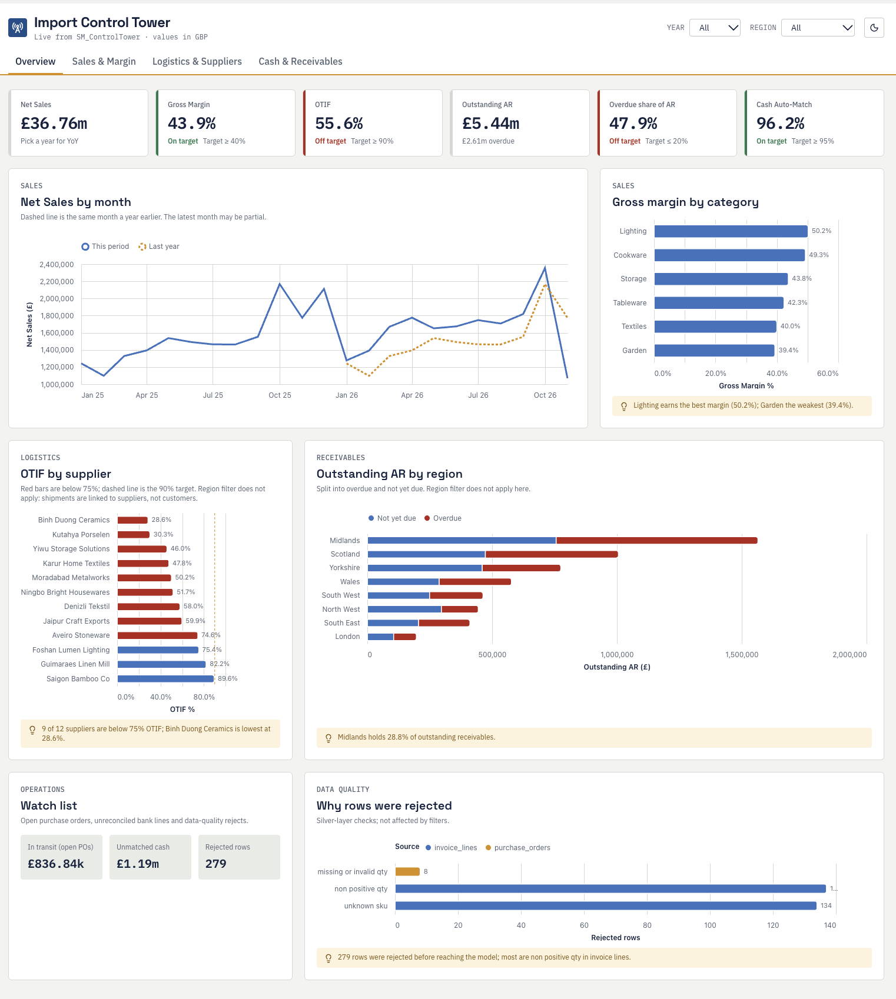
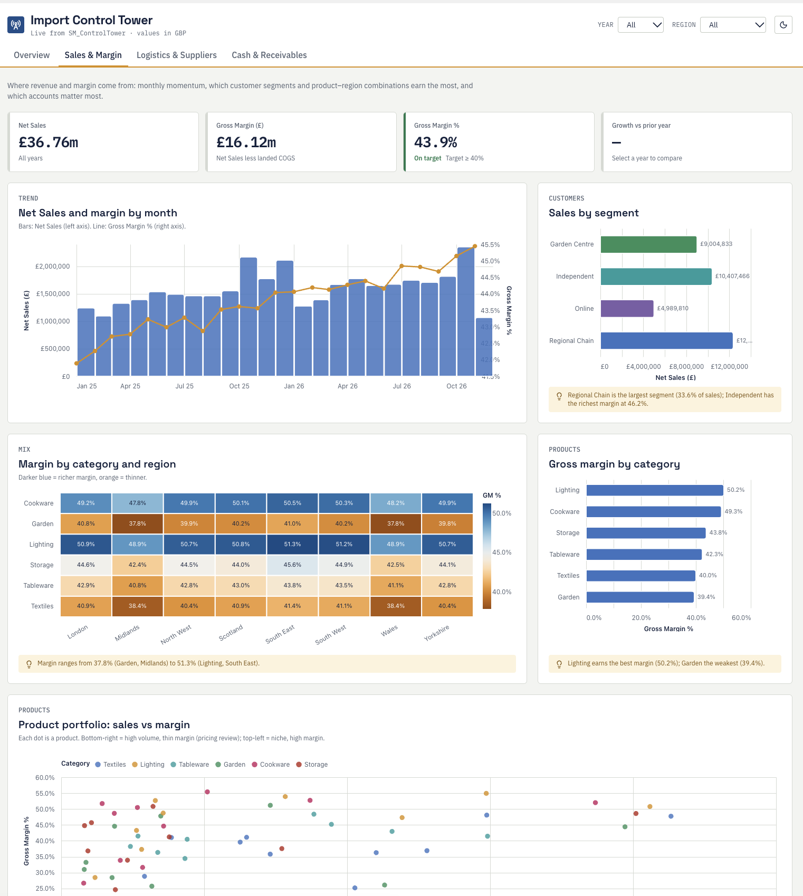
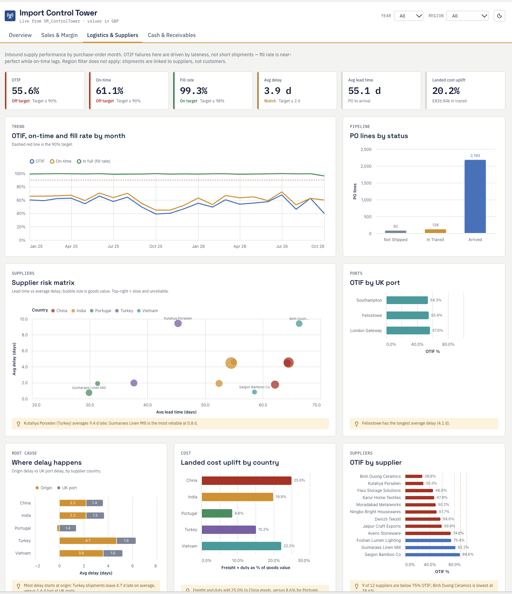
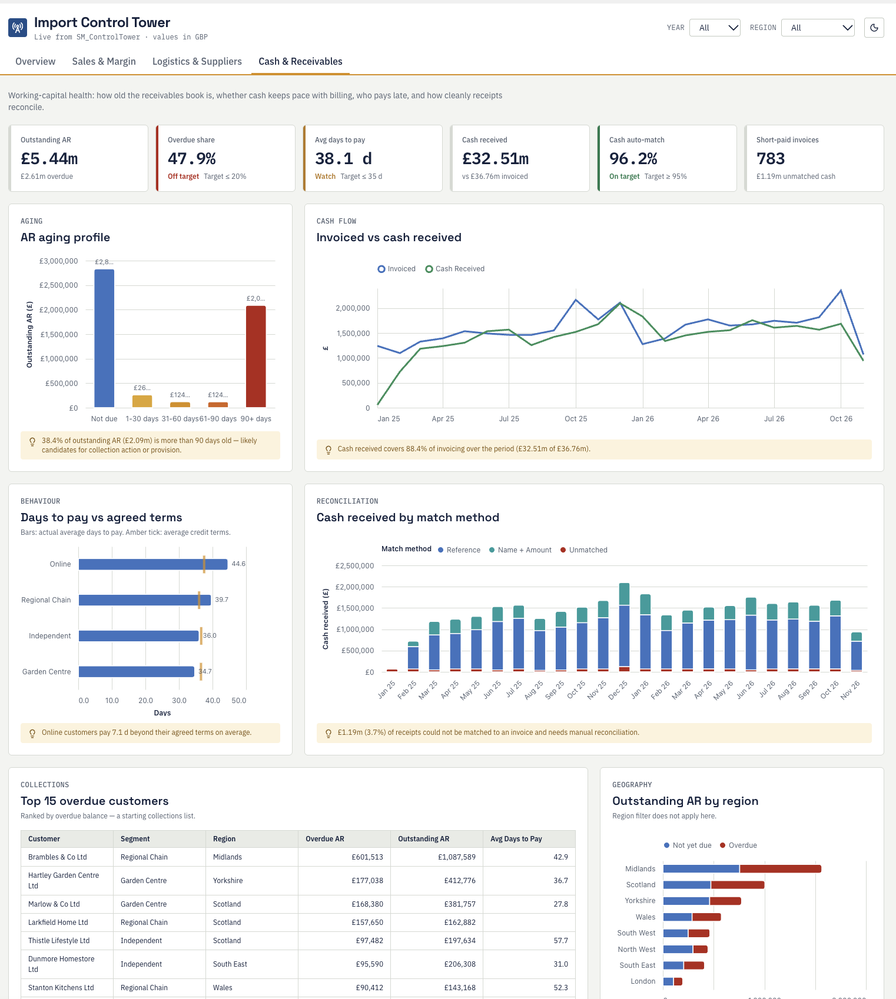
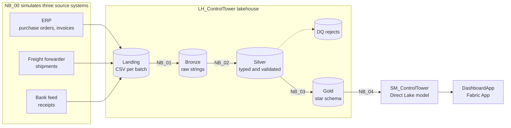
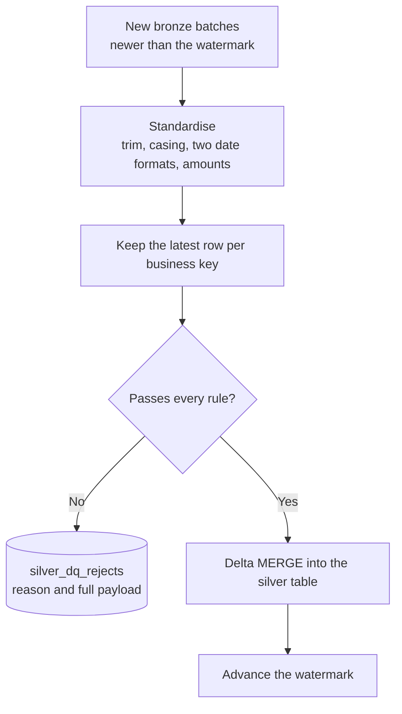
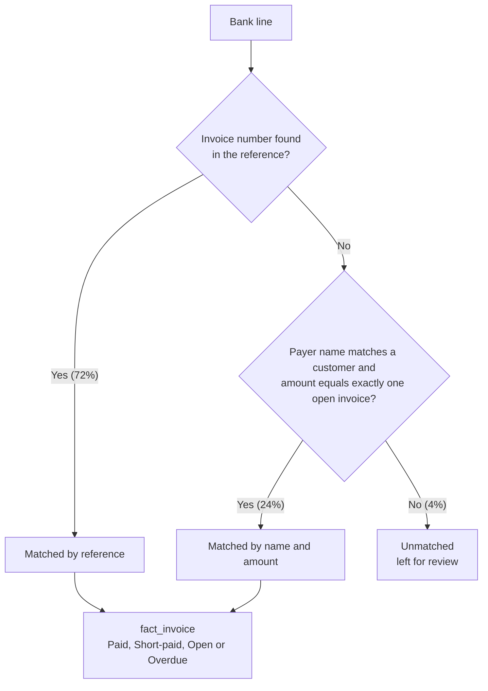
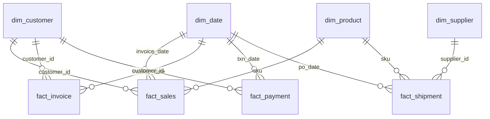
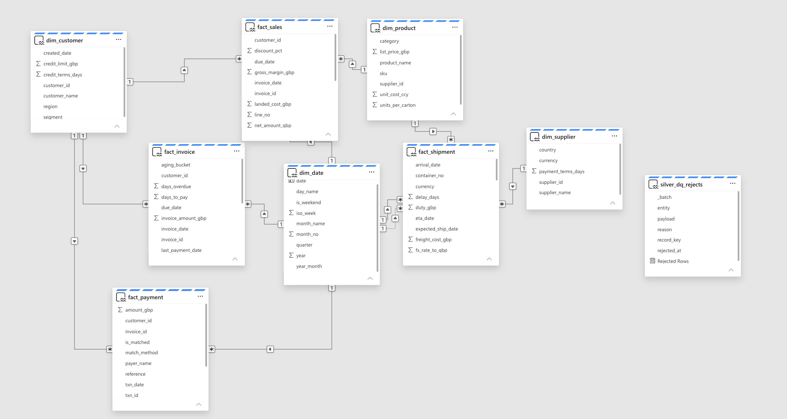

# Import Control Tower on Microsoft Fabric

An end-to-end Fabric lakehouse project for a fictional UK homeware importer, **Calder & Wren Imports Ltd**.
It takes messy daily exports from three source systems and answers three questions an importer's
finance and operations teams ask every week:

| Question | Why it is hard | Where it is answered |
|---|---|---|
| Which suppliers can we rely on? | Shipment rows are re-sent as their status changes; "late" depends on what was promised | `fact_shipment` – delay days, fill rate, OTIF |
| What do products really cost once they land? | Cost is in USD/EUR, freight and duty arrive later and per shipment | `fact_shipment` landed cost → `fact_sales` margin |
| Who has actually paid us? | Bank lines carry free-text references, name variants, short payments | `fact_payment` reconciliation → `fact_invoice` receivables |

All data is synthetic. No real company's data is used.

**Status:** the lakehouse pipeline, the Direct Lake semantic model and a Fabric App (preview) dashboard
on top of it are all running in one Fabric workspace.

## The app

`DashboardApp` is a Fabric App that queries `SM_ControlTower` live with DAX. It has four pages, with
year and region filters and a light/dark toggle.

### Overview

### Sales & Margin

### Logistics & Suppliers

### Cash & Receivables

## Repository layout

| Path | What it is |
|---|---|
| `notebooks/NB_00_Generate_Data.ipynb` | Source-system simulator: writes a new batch of CSV drops on every run |
| `notebooks/NB_01_Bronze_Ingest.ipynb` | Append-only raw load, incremental by batch folder |
| `notebooks/NB_02_Silver_Clean.ipynb` | Typing, de-duplication, validation, Delta `MERGE`, reject log |
| `notebooks/NB_03_Gold_Model.ipynb` | Star schema, landed cost, bank-to-invoice reconciliation |
| `notebooks/NB_04_Semantic_Model.ipynb` | Direct Lake semantic model, relationships and measures as code |
| `semantic_model/measures.dax` | The measures in plain DAX for reference |
| `docs/images/` | Screenshots of the app and the semantic model |

## Architecture

A data pipeline runs the notebooks in order.

| Layer | Tables | Load pattern |
|---|---|---|
| Landing | CSV per entity per batch folder | Written by the simulator |
| Bronze | `bronze_<entity>` (8 tables) | Append; only batch folders newer than the table's high-water mark are read |
| Silver | `silver_<entity>`, `silver_dq_rejects`, `ctl_watermark` | Incremental from bronze by watermark, Delta `MERGE` on business key |
| Gold | `dim_date`, `dim_customer`, `dim_product`, `dim_supplier`, `fact_sales`, `fact_shipment`, `fact_invoice`, `fact_payment` | Full rebuild (small) |

## What makes the data realistic

The simulator replays the business day by day from a fixed seed, so runs are reproducible, and writes
only events after its watermark, so each run looks like a new nightly drop. It injects the problems
the pipeline has to handle:

| Problem in the source | How it is handled |
|---|---|
| Exact duplicate rows | Latest row per business key in silver |
| Shipment sent twice (In Transit, then Arrived) | `MERGE` updates the row in place; "Arrived" wins inside a batch |
| Two date formats in one column (ISO and dd/MM/yyyy) | `parse_date` tries both |
| Amounts with thousands separators (`"1,234.50"`) | Stripped before casting to decimal |
| Inconsistent casing and padding in keys and currency codes | Trim + upper |
| Orphan SKUs, missing or negative quantities | Routed to `silver_dq_rejects` with a reason and the full payload |
| Late-arriving invoices | Picked up by batch watermark, not by business date |
| Free-text bank references, payer name variants, short payments, non-customer receipts | Two-pass reconciliation in gold |

### How a batch moves through silver

## Reconciliation logic

Percentages are shares of the 17,494 bank lines in a local test run.

1. **Reference match** – a regex pulls the invoice number out of references such as `inv 123`,
   `INV_000123` or `Payment INV000123 thanks`.
2. **Name + amount match** – for the remainder, the payer name is normalised (case, punctuation,
   `Limited`/`Ltd`, `&`/`and`) and matched to a customer where the amount equals exactly one open
   invoice and that invoice has exactly one candidate payment.
3. Everything else is left **Unmatched** for review rather than guessed.

Matched receipts roll up to `fact_invoice`, which gives status (Paid, Short-paid, Open, Overdue),
days to pay and an aging bucket per invoice.

## Results

Figures from the deployed app, history from 1 Jan 2025 to mid-Nov 2026:

| Metric | Value |
|---|---|
| Net sales | £36.76m |
| Gross margin after landed cost | 43.9% |
| Supplier OTIF | 55.6% overall, with on-time at 61.1% and fill rate at 99.3% |
| Freight + duty on top of goods value | 20.2% |
| Outstanding receivables | £5.44m, of which 47.9% overdue |
| Bank lines reconciled automatically | 96.2% |

In a local test run against the simulator's ground truth, the reconciliation made 0 wrong matches.

## Run it yourself

1. Create a workspace on a Fabric capacity (trial works) and a lakehouse named `LH_ControlTower`.
2. Import the notebooks from `notebooks/` (Workspace → Import → Notebook) and attach
   `LH_ControlTower` as the **default lakehouse** of each.
3. Run in order: `NB_00_Generate_Data` → `NB_01_Bronze_Ingest` → `NB_02_Silver_Clean` → `NB_03_Gold_Model`.
   The first run back-fills history in monthly batches; every later run adds one new batch.
4. Create a data pipeline `PL_ControlTower_Daily` with the first four notebooks as Notebook activities chained on success,
   and schedule it daily.
5. Run `NB_04_Semantic_Model`. It creates the Direct Lake model `SM_ControlTower` with
   Semantic Link Labs, adds the relationships and measures below, and smoke-tests it with a DAX query.

### Star schema

### Semantic model in Fabric

### Relationships (all many-to-one, single direction)

| From | To | Active |
|---|---|---|
| `fact_sales[invoice_date]` | `dim_date[date]` | Yes |
| `fact_sales[customer_id]` | `dim_customer[customer_id]` | Yes |
| `fact_sales[sku]` | `dim_product[sku]` | Yes |
| `fact_invoice[invoice_date]` | `dim_date[date]` | Yes |
| `fact_invoice[customer_id]` | `dim_customer[customer_id]` | Yes |
| `fact_payment[txn_date]` | `dim_date[date]` | Yes |
| `fact_payment[customer_id]` | `dim_customer[customer_id]` | Yes |
| `fact_shipment[po_date]` | `dim_date[date]` | Yes |
| `fact_shipment[arrival_date]` | `dim_date[date]` | No (used via `USERELATIONSHIP`) |
| `fact_shipment[supplier_id]` | `dim_supplier[supplier_id]` | Yes |
| `fact_shipment[sku]` | `dim_product[sku]` | Yes |
| `dim_product[supplier_id]` | `dim_supplier[supplier_id]` | No (avoids an ambiguous path) |

`dim_date` is marked as the date table. Measures are in [`semantic_model/measures.dax`](semantic_model/measures.dax).

## Design decisions

- **Bronze keeps everything as strings.** Type problems surface in silver as logged rejects instead of failed loads.
- **Rejects are data, not errors.** Bad rows are stored with reason and payload so they can be fixed at source and replayed.
- **Watermarks by batch, not business date.** Late-arriving records are never missed.
- **Reconciliation prefers "unmatched" over a wrong match.** The name + amount pass only accepts one-to-one candidates.
- **Gold is rebuilt in full.** At this size it is simpler and safer than incremental facts; silver carries the incremental logic.

## Possible extensions

- Time-phased landed cost (monthly weighted average) instead of one average per SKU
- SCD Type 2 on customer credit terms
- One bank payment settling several invoices
- Deployment pipeline with dev and prod workspaces, and Git integration

## Licence

MIT. See [LICENSE](LICENSE).
